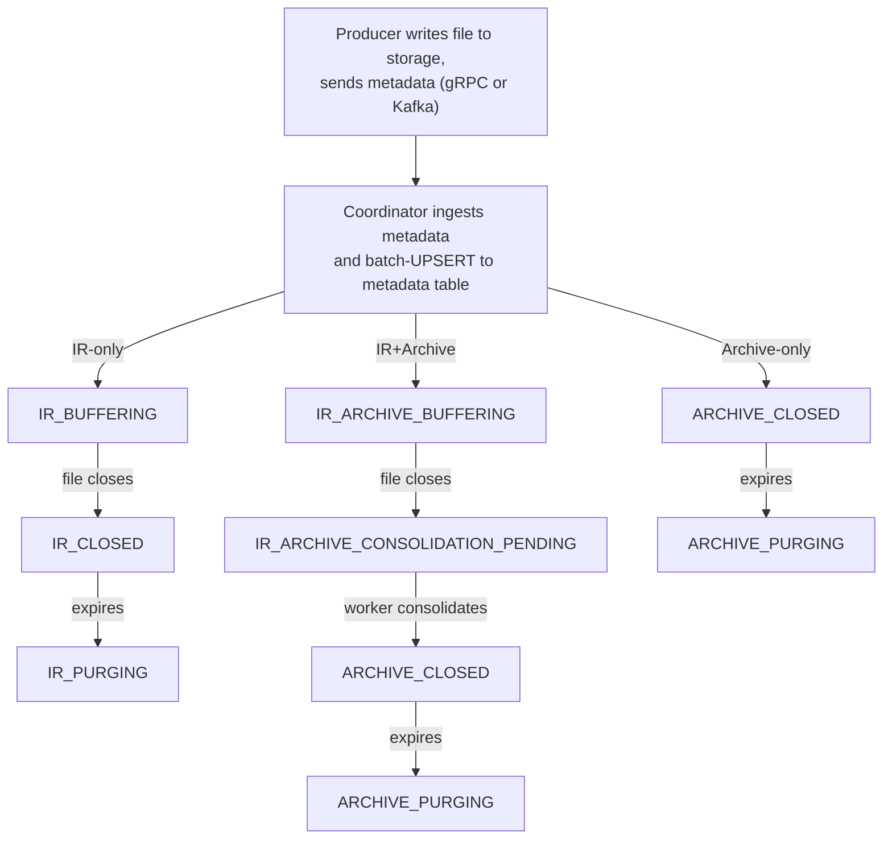

# Deletion & Lifecycle

[← Back to docs](../README.md)

Files progress through forward-only lifecycle states from ingestion to deletion. Each file's entry type determines its initial state and the transitions it will follow. States never regress — once a file advances past a state, late re-deliveries or retries cannot move it backward. This document covers the full lifecycle, retention semantics, and storage cleanup.

**Related:** [Metadata Schema](metadata-schema.md) · [Consolidation](consolidation.md) · [Architecture Overview](overview.md) · [Naming Conventions](../reference/naming-conventions.md)

---

## File Lifecycle States

Seven states, organized by file format:

| State | Entry Type | Description |
|-------|-----------|-------------|
| `IR_BUFFERING` | IR-only | IR file actively receiving writes |
| `IR_CLOSED` | IR-only | IR file closed, queryable, awaiting retention expiry |
| `IR_PURGING` | IR-only | IR file being deleted from storage |
| `IR_ARCHIVE_BUFFERING` | IR+Archive | IR file actively receiving writes, will be consolidated |
| `IR_ARCHIVE_CONSOLIDATION_PENDING` | IR+Archive | IR file closed, awaiting consolidation into archive |
| `ARCHIVE_CLOSED` | Archive-only or IR+Archive | Archive ready (from batch upload or after consolidation) |
| `ARCHIVE_PURGING` | Archive-only or IR+Archive | Archive being deleted from storage |



All transitions are forward-only. The UPSERT guard (`state NOT IN (...)` + timestamp guard) prevents late re-deliveries from regressing state. See [Metadata Schema: UPSERT Strategy](metadata-schema.md#upsert-strategy).

---

## Entry Types

The entry type is determined at file creation and controls which lifecycle path the file follows.

### IR-only

Ephemeral data (test logs, short-lived debug streams) that expires without consolidation.

```
IR_BUFFERING → IR_CLOSED → IR_PURGING → (deleted)
```

The IR file is queryable from `IR_BUFFERING` onward. After retention expires, the coordinator marks the row `IR_PURGING`, the Storage Deletion goroutine removes the file from object storage, and the row is deleted.

### Archive-only

Batch-ingested archives with no source IR file. Created directly as `ARCHIVE_CLOSED`.

```
ARCHIVE_CLOSED → ARCHIVE_PURGING → (deleted)
```

### IR+Archive

Streaming data that will be consolidated into a columnar archive. This is the most common production path.

```
IR_ARCHIVE_BUFFERING → IR_ARCHIVE_CONSOLIDATION_PENDING → ARCHIVE_CLOSED → ARCHIVE_PURGING → (deleted)
```

After consolidation completes, the source IR file in object storage is scheduled for deletion. The metastore row transitions to `ARCHIVE_CLOSED` with `archive_path` set — `file_path` is preserved in the row as provenance. The many-to-one relationship (multiple IR files per archive) is tracked via the shared `archive_path` value. See [Consolidation: IR to Archive Relationship](consolidation.md#ir-to-archive-relationship).

---

## Retention

### How `expires_at` is Set

`expires_at` is a required field in the database (no default). If the producer provides `expires_at`, that value is used as-is. If the producer sends `expires_at = 0` (or omits it), the coordinator computes it server-side as `min_timestamp + (retention_days × 86400 × 1e9)` (epoch nanoseconds). If `retention_days` is also zero, it defaults to 30 days. Because `min_timestamp` is the partition key, this creates a strong temporal correlation: files in old partitions expire sooner; files in new partitions expire later.

### Per-File Retention Updates

Retention is managed at **file granularity** — each row carries its own `expires_at`. This can be updated at any time via standard SQL, using any combination of dimensions, time ranges, or other predicates:

```sql
-- Extend retention during a security incident
UPDATE clp_spark
SET retention_days = 395, expires_at = min_timestamp + (395 * 86400 * 1000000000)
WHERE dim_str128_service = 'auth-service'
  AND min_timestamp >= [INCIDENT_START]
  AND min_timestamp <= [INCIDENT_END]
  AND retention_days < 395
LIMIT 10000;
```

This is a first-class operational capability — no special API required. Any database query that selects the right subset of files can update their retention. Common use cases:

| Scenario | Filter | Action |
|----------|--------|--------|
| Security incident | Service + time range | Extend retention for forensic analysis |
| Compliance hold | Dimension (region, customer) | Prevent deletion of regulated data |
| Cost reduction | Large services past SLA | Shorten retention |
| Debug investigation | Specific host/job + time window | Extend retention temporarily |

### Deletion Ordering

Deletions are row-level, driven by `idx_expiration` (scan `expires_at ASC`, batch delete). Each file carries its own `expires_at` reflecting its individual retention policy. Because `expires_at` correlates with `min_timestamp`, deletions cluster in the oldest (coldest) partitions — never in the hot recent partition. Deletions proceed in roughly storage order: the oldest rows in the oldest partition expire first, matching their physical B-tree position.

### Why Fragmentation is Benign

- Deletions are batched in large chunks in roughly storage order, so most pages drain completely within one or a few batch operations. InnoDB reclaims fully empty pages whole.
- Page compression with `PUNCH_HOLE` handles partially-drained pages: as rows are deleted, the compressed size shrinks, and InnoDB returns freed filesystem blocks to the OS.
- All fragmentation stays in cold, old partitions — the hot recent partition is unaffected.

---

## Retention Strategy

The Rust coordinator runs a retention task when `retention.enabled` is `true` in the stored table configuration. Retention is disabled by default. The supported strategy is `"default"` (an empty type also selects it). Enabling retention requires configured storage backends. Configuration changes take effect when the owning node next reconciles the table.

### How It Works

The default retention strategy runs a three-phase cleanup cycle every 60 seconds:

1. **Mark expired rows**: Transition files past `expires_at + grace_period_secs` to `IR_PURGING` or `ARCHIVE_PURGING`. The row remains durable deletion work.
2. **Retire and delete objects**: For each original-file and archive location, check both storage fields across all registered tables. A live reference protects the object. Otherwise, record its retirement in `_storage_tombstone`, then delete the storage object. Requests are rate limited and bounded to 30 seconds.
3. **Remove completed metadata**: Delete the expired row only when each object was successfully deleted, was already absent, or is still represented by a live reference elsewhere. Use the complete `(min_timestamp, id)` primary key.

The database-scoped `StorageMutationGuard` serializes each ingestion chunk's tombstone check and commit with retention's reference check and tombstone insertion. It is released before storage I/O; no SQL transaction spans a storage request. This prevents an ingestion request from creating a new reference between the last-reference check and deletion. It also serializes metadata commit sections across tables, so throughput should be measured with representative batch sizes and storage-location counts.

Before each cycle, retention audits both storage fields in every registered table, including inactive tables. Missing backend or bucket identities block deletion globally, including for native AWS S3, because a legacy default bucket may alias an explicit bucket. For configured backends that require canonical keys (filesystem and custom S3 endpoints), leading, repeated, or trailing slashes, dot components, backslashes, and ambiguous bucket values also block the cycle before metadata changes or deletions. This protects legacy references such as `/a` when an endpoint resolves them to the same object as `a`. Existing keys are never silently rewritten; native AWS S3 keys remain verbatim. The audit uses database predicates rather than loading all records into memory, but it can scan metadata across all tables once per table retention cycle. Account for that database cost when setting scan intervals. Audit results are not cached.

### Crash Safety via PURGING States

The three-phase process provides crash safety:

- A crash, cancellation, missing backend, or failed storage request leaves the `PURGING` row for retry by the next cycle or owner.
- If storage deletion succeeded before a crash, the next retry treats the missing object as success and removes the row.
- A tombstone is written before issuing a deletion request. Ingestion rejects subsequent references to that retired location, including after its metadata row is gone. **Object names are immutable and must not be reused after retirement.** Tombstones are retained permanently and require storage capacity planning; deleting them manually removes this protection.
- Storage identity is the exact `(backend name, bucket, object key)` tuple. Every node must map backend names consistently to physical storage. Producers must provide explicit backend and bucket values; unresolved legacy records remain pending instead of relying on implicit defaults. Different names must not alias the same physical storage location. Direct SQL writes that bypass the mutation guard are outside this concurrency protocol.
- Failed rows do not monopolize the next scan: the scanner pages through pending work and wraps to retry earlier failures.

### Rate Limiting

Storage deletion defaults to 500 operations per second per table coordinator. Set `retention.delete_rate`, `retention.scan_interval_secs`, and `retention.grace_period_secs` in the table configuration to adjust this behavior. These limits are per coordinator, not a cluster-wide storage limit.

### Extensibility

The Rust `RetentionPolicy` trait allows alternate implementations in code. Runtime configuration currently accepts only the built-in default strategy; unsupported strategy names produce an error.

---

## Partition Cleanup

After the retention strategy deletes expired rows, old partitions become empty or sparse. The `PartitionManager` — running as a per-coordinator goroutine hourly — drops empty partitions and merges sparse partitions into `p_floor`.

| Condition | Action |
|-----------|--------|
| Empty (0 rows) | Drop partition |
| Sparse (has rows) | Merge into `p_floor` via `REORGANIZE PARTITION` |

Only partitions older than the cleanup age (default: 90 days) are candidates. `p_floor` and `p_future` are structural bookends — never dropped or merged away. Empty old partitions are dropped; sparse ones are merged into `p_floor`, expanding its boundary while preserving all rows. For full details on partition layout, advisory lock coordination, and maintenance operations, see [Metadata Schema: Partitioning](metadata-schema.md#partitioning).

---

## See Also

- [Metadata Schema](metadata-schema.md) — Entry types, UPSERT guards, partitioning, retention details
- [Consolidation](consolidation.md) — IR-to-Archive pipeline, state transitions during consolidation
- [Architecture Overview](overview.md) — Goroutine model, startup/shutdown sequences
- [Naming Conventions](../reference/naming-conventions.md) — Lifecycle state naming patterns
- [Task Queue Design](../design/task-queue.md) — How consolidation tasks are claimed and completed
